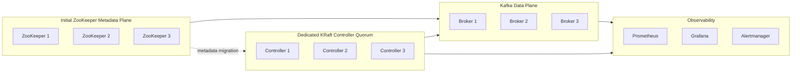
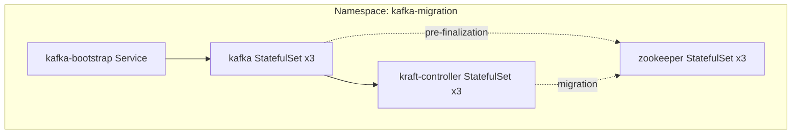

# Architecture

This document describes the repository target state and migration phases.

## Target Components

## Migration Phases

1. Pre-check the ZooKeeper cluster, brokers, topics, ACLs, consumer groups, and
   client compatibility.
2. Start the dedicated KRaft controllers in migration mode.
3. Roll the brokers with migration-aware configuration.
4. Verify metadata parity, client traffic, replication health, and ACL behavior.
5. Finalize the brokers in KRaft mode and remove ZooKeeper dependencies.
6. Keep rollback artifacts until the post-migration acceptance window closes.

Each phase has a script and a documented runbook.

## Kubernetes Topology

The Kubernetes deployment uses StatefulSets and headless services so each
ZooKeeper node, broker, and controller keeps stable network identity and durable
storage.

